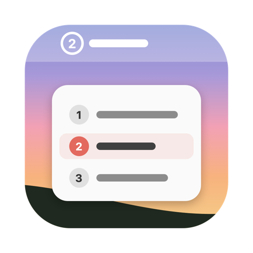
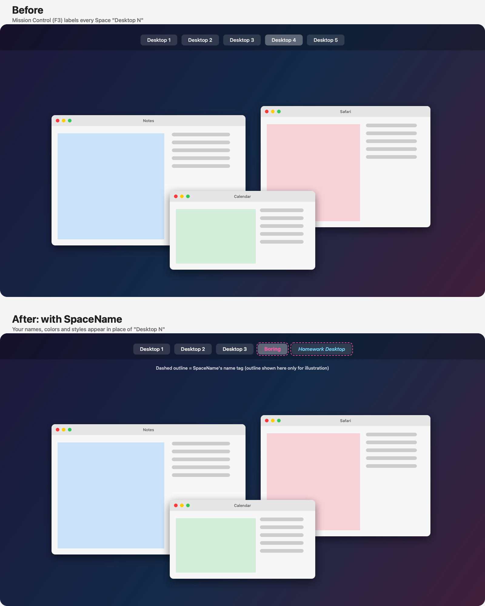

<p align="center">
  
</p>

<h1 align="center">SpaceName</h1>

<p align="center">
  <b>Give your Mac's desktops real names.</b><br>
  "Desktop 4" becomes "Homework", in the menu bar and in Mission Control,<br>
  in the color and style you pick.
</p>

<p align="center">
  <a href="https://github.com/jiachengw-sf/SpaceName/releases/latest"><b>⬇ Download</b></a> ·
  <a href="#-features">Features</a> ·
  <a href="#-build-from-source">Build from source</a> ·
  <a href="#-private-apis">How it works</a>
</p>

<p align="center">
  
  
  
  
</p>

---

> [!WARNING]
> **Unsigned build.** SpaceName isn't signed with an Apple Developer ID or
> notarized, so macOS blocks the first launch. Right-click the app and choose
> **Open**, or allow it under *System Settings › Privacy & Security*.

> [!NOTE]
> **Mission Control names are in beta and off by default.** To try them, open
> the SpaceName menu › *SpaceName Settings…* › **Show Names in Mission Control (Beta)**.
> They cover the "Desktop N" labels when you hover the top bar in Mission Control,
> but can lag during its animations and don't appear on the collapsed bar.

## 🪟 What is this?

You have eight desktops: one for school, one for a side project, one for music.
macOS calls them all "Desktop 1" through "Desktop 8", so you swipe around
guessing. SpaceName puts the real name of the desktop you're on in the menu bar,
lets you rename any of them in one click, and shows those names in Mission
Control too.

<p align="center">
  
</p>

## ✨ Features

- **Menu bar label:** the desktop number in a circle plus its name, in its own color
  and bold/italic style.
- **Native-looking dropdown:** styled like the Wi-Fi menu (Liquid Glass on macOS 26),
  in light or dark mode. Click a desktop to switch to it.
- **Keyboard shortcuts:** ⌥1 – ⌥9 jump to desktops 1–9, ⌥0 to desktop 10, and
  ⌥⇧1 – ⌥⇧6 to desktops 11–16 (the most macOS allows). Only desktops you have get a
  shortcut; those keys stop typing their special character (™, •, …), so turn shortcuts
  off in Settings if you need them.
- **Quick rename:** hover a desktop, click the pencil, and type. Return saves, Esc cancels.
- **Colors and styles:** presets or any custom color, with a light and dark menu bar
  preview and a warning when a color is hard to read.
- **Names in Mission Control (beta, off by default):** your names cover the
  "Desktop N" labels when you hover the top bar in Mission Control (F3).
- **Launch at login**, no Dock icon, and names that stay attached to the right
  desktop even when you reorder, add or remove them.

Requires macOS 14 or later.

## ⬇️ Install

1. Download `SpaceName-<version>.zip` from
   [Releases](https://github.com/jiachengw-sf/SpaceName/releases/latest), unzip it,
   and move `SpaceName.app` to `/Applications`.
2. Open it (see the warning above for the first launch).
3. To switch desktops (clicking a row or ⌥ + number) and to show names in Mission
   Control, allow SpaceName under *Privacy & Security › Accessibility* when asked.

## 🛠 Build from source

Only the Xcode Command Line Tools are needed.

```bash
scripts/build_app.sh            # release build → build/SpaceName.app
scripts/build_app.sh debug      # debug build
open build/SpaceName.app
```

To quit: *SpaceName Settings…* › Quit SpaceName, or `pkill -x SpaceName`.

### Signing and the Accessibility permission

Switching Spaces posts keyboard events, which needs **Accessibility** permission.
macOS ties that permission to the app's code signature.

- **Ad-hoc signing (default)**: the signature changes on every rebuild, so the
  permission stops working after each build. In practice macOS can also keep
  recording an older build's signature even after you remove and re-add the app.
- **Self-signed certificate (recommended for development)**: create one once and
  the permission survives rebuilds. In Keychain Access choose
  *Certificate Assistant › Create a Certificate…*, name it `SpaceName Dev`, set
  Identity Type to *Self-Signed Root* and Certificate Type to *Code Signing*.
  `build_app.sh` picks it up automatically (or set `SIGN_IDENTITY` to use another).
  After switching to the certificate, remove SpaceName from
  *Privacy & Security › Accessibility* with **−** and grant it again once.

### Switching setup

Switching (clicking a row or pressing ⌥ + number) presses your Mission Control shortcuts, using the key bindings
actually configured in *System Settings › Keyboard › Keyboard Shortcuts… ›
Mission Control*:

1. **Switch to Desktop N** (off by default): jumps straight there. Turn these on
   for the best experience.
2. **Move left/right a space** (on by default): used as a fallback, stepping
   one Space at a time. This is also the only way to reach full-screen app Spaces.

If neither is available, or permission is missing, the panel shows a banner that
links to the right settings page.

### Launch at login

Uses `SMAppService.mainApp`. It registers the bundle at its current path, so move
`SpaceName.app` to `/Applications` first if you want it to survive rebuilds or
cleanups of `build/`.

### Names in Mission Control

macOS draws the "Desktop N" labels itself and can't be told to use other names.
SpaceName instead places a click-through window above Mission Control with a
name tag over each renamed Space's label (see
[the mockup](docs/mission-control-overlay-mockup.png)). It finds the labels
through the Dock's accessibility tree, so it needs the same Accessibility
permission as switching. While Mission Control is closed it checks for it four
times a second; while open it follows the labels 30 times a second so tags
keep up when the bar expands on hover. It is off by default; turn it on in *SpaceName Settings…* › **Show Names in Mission Control (Beta)**.

## 💾 Data

Names and styles are stored in
`~/Library/Application Support/SpaceName/spaces.json`, keyed by each Space's
UUID. Reordering, adding, or removing Spaces never attaches a name to the wrong
Space. Full-screen app Spaces have no UUID, so they are labeled with the app's
name and can't be renamed.

## 🔍 Private APIs

macOS has no public API for Spaces. All private calls are in
[`SpaceProvider.swift`](Sources/SpaceName/SpaceProvider.swift), declared with
`@_silgen_name` so a future macOS change only needs fixing in one file.

| Function | Used for |
|---|---|
| `CGSMainConnectionID` | Connection to the window server |
| `CGSGetActiveSpace` | ID of the active Space |
| `CGSCopyManagedDisplaySpaces` | Every display's Spaces: ID, UUID, type (desktop or full screen), current Space |
| `CGSCopyActiveMenuBarDisplayIdentifier` | Which display has the menu bar, when displays have separate Spaces |

These come from SkyLight and are re-exported by CoreGraphics. They are not
App Store safe.

Other semi-private details:

- [`DockMissionControl.swift`](Sources/SpaceName/DockMissionControl.swift) reads
  the Dock's undocumented accessibility identifiers (`mc`, `mc.display`,
  `mc.spaces.list`, `AXDisplayID`) to find the Spaces bar. A macOS update that
  changes them only needs fixing there.
- Mission Control shortcut bindings are read from the
  `com.apple.symbolichotkeys` preferences (`AppleSymbolicHotKeys`; IDs 79/81 for
  move left/right, 118–133 for Desktop 1–16).
- "Desktop N" shortcut numbers count desktops across all displays in the order
  `CGSCopyManagedDisplaySpaces` returns them. This has only been checked on a
  single display.

### Why not switch Spaces with CGS directly?

Private calls such as `CGSManagedDisplaySetCurrentSpace` (or the
`CGSShowSpaces`/`CGSHideSpaces` pair) change what the window server shows, but
not the Dock's idea of the current Space. Dock owns Mission Control. The result
is a desynchronized state: the wrong windows stay visible or get focus, Mission
Control and the menu bar show the old Space, and the next real switch can jump
unexpectedly. Tools that switch Spaces reliably this way (for example yabai)
inject code into Dock.app, which requires partially disabling System Integrity
Protection. Posting the user's own Mission Control shortcuts is slower and needs
Accessibility permission, but it goes through Dock and stays consistent.

## 🗂 Project layout

```
Package.swift                 SwiftPM manifest
Resources/Info.plist          Bundle metadata (LSUIElement)
scripts/build_app.sh          Build, bundle, sign
Sources/SpaceName/
  SpaceProvider.swift         Private CGS calls (only file using private API)
  SpaceModel.swift            Space / SpaceSnapshot
  SpaceStore.swift            JSON persistence keyed by UUID
  LabelStyle.swift            Fonts, colors, contrast check
  SpaceSwitcher.swift         Shortcut lookup and CGEvent posting
  DesktopHotkeys.swift        ⌥ + number global shortcuts
  DockMissionControl.swift    Reads Mission Control's Spaces bar (Dock internals)
  MissionControlOverlay.swift Name tags drawn over Mission Control
  LoginItem.swift             SMAppService wrapper
  AppModel.swift              Live state + inline edit state
  AppDelegate.swift           Wiring and Space-change notifications
  StatusItemController.swift  Menu bar item
  PanelController.swift       Borderless blurred dropdown panel
  Views/                      SwiftUI rows, rename field, style editor, settings menu
```
