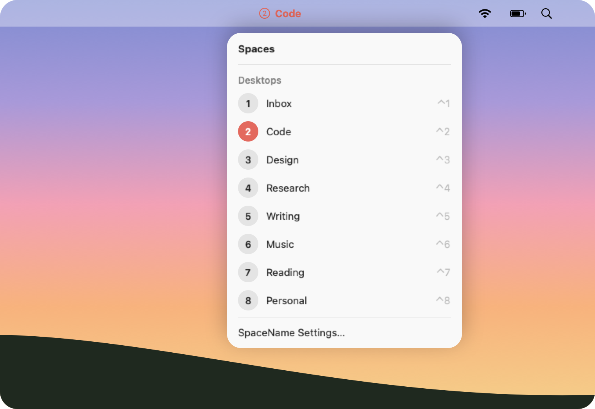

<p align="center">
  
</p>

<h1 align="center">SpaceName</h1>

<p align="center">
  <b>Know which desktop you're on, at a glance.</b><br>
  SpaceName puts your desktop's name in the menu bar, so "Desktop 4" becomes "Homework",<br>
  in the color and style you pick. Switch desktops with a click or your keyboard.
</p>

<p align="center">
  <a href="https://github.com/jiachengw-sf/spacename-menubar/releases/latest"><b>⬇ Download</b></a> ·
  <a href="#-features">Features</a> ·
  <a href="#-requirements">Requirements</a> ·
  <a href="#-build-from-source">Build from source</a> ·
  <a href="#-privacy">Privacy</a>
</p>

<p align="center">
  
  
  
  
</p>

<p align="center">
  
</p>

> [!WARNING]
> **First launch needs one extra step.** SpaceName isn't notarized by Apple, so
> macOS can't verify the developer and blocks the first launch. See
> [Opening it the first time](#opening-it-the-first-time).

## 🪟 What is this?

You have eight desktops: one for class, one for a side project, one for music.
macOS calls them "Desktop 1" through "Desktop 8", so you swipe around guessing.
SpaceName shows the name of the desktop you're on in the menu bar, lists all of
them one click away, and lets you rename, color, and jump to any of them.

## ✨ Features

- **Menu bar label:** the current desktop's number in a circle and its name, like
  ⑤ Writing, in the color and bold/italic style you choose.
- **Native dropdown:** styled like the Wi-Fi menu (Liquid Glass on macOS 26), in
  light or dark mode. The current desktop is highlighted with your accent color.
- **Rename in place:** hover a desktop, click the pencil, and type. Return saves,
  Esc cancels. Leave it empty to go back to "Desktop N".
- **Colors and styles:** preset or custom colors, bold and italic, with a light and
  dark menu bar preview and a warning when a color would be hard to read.
- **Switch with a click:** click any desktop in the list to go there.
- **Works with macOS's shortcuts:** each row shows its macOS "Switch to Desktop"
  shortcut (⌃1, ⌃2…). If some are turned off, *Turn On Desktop Shortcuts…* takes you
  to the setting (see [Switching setup](#switching-setup)).
- **Names stay put:** names are tied to each desktop itself, not its position, so
  reordering, adding, or removing desktops never puts a name on the wrong one.
- **Launch at login**, no Dock icon, and full-screen app Spaces listed by app name.

### 🧪 Beta: names in Mission Control (off by default)

SpaceName can also cover Mission Control's "Desktop N" labels with your names
when you hover the top bar in Mission Control (F3). It's off by default because it
can lag during Mission Control's animations and doesn't label the collapsed bar.
To try it: SpaceName menu › *SpaceName Settings…* › **Show Names in Mission Control (Beta)**.

<details>
<summary>What it looks like</summary>
<br>

</details>

## ⬇️ Install

1. Download `SpaceName-<version>.dmg` from
   [Releases](https://github.com/jiachengw-sf/spacename-menubar/releases/latest)
   (a `.zip` is there too if you prefer).
2. Open the `.dmg` and drag **SpaceName** onto the **Applications** shortcut.
3. Open SpaceName from Applications (see [Opening it the first time](#opening-it-the-first-time)).
   It appears in the menu bar, not the Dock.
4. To switch desktops by clicking, allow SpaceName under
   *System Settings › Privacy & Security › Accessibility* when asked.
5. Recommended: turn on macOS's desktop shortcuts (see [Switching setup](#switching-setup)).

### Opening it the first time

macOS warns that it can't verify the developer, because notarization requires a
paid Apple Developer account. You only need to do this once.

- **macOS 15 Sequoia and later:** open SpaceName, click **Done** on the warning,
  then go to *System Settings › Privacy & Security*, scroll down, click
  **Open Anyway** next to SpaceName, and confirm with your password.
- **macOS 14 Sonoma:** right-click (or Control-click) SpaceName in Applications,
  choose **Open**, then click **Open** in the dialog.

## 📋 Requirements

| | |
|---|---|
| **Mac** | Apple silicon or Intel (universal app) |
| **macOS** | 14 Sonoma or later. The glass panel needs macOS 26; earlier versions get a frosted panel. |
| **Displays** | Any size, including external monitors. SpaceName shows the desktops of the display with the menu bar. |
| **Desktops** | Up to 16 per display, the most macOS allows |

| Permission | Needed for | Without it |
|---|---|---|
| None | Menu bar name, renaming, colors and styles | All of these work |
| **Accessibility** | Switching desktops from SpaceName, and the Mission Control beta | The panel shows a "Permission needed" banner; everything else works |

## 🛠 Build from source

Needs macOS 14+ and the Xcode Command Line Tools (`xcode-select --install`).
Full Xcode isn't required.

```bash
scripts/build_app.sh            # release build (universal) → build/SpaceName.app
scripts/build_app.sh debug      # faster debug build for this Mac only
scripts/make_dmg.sh             # package build/SpaceName.app as a .dmg
open build/SpaceName.app
```

To quit: *SpaceName Settings…* › Quit SpaceName, or `pkill -x SpaceName`.

### Signing and the Accessibility permission

macOS ties the Accessibility permission to the app's code signature.

- **Ad-hoc signing (default):** the signature changes on every rebuild, so the
  permission stops working after each build, and macOS may keep an older build's
  record even after you remove and re-add the app.
- **Self-signed certificate (recommended for development):** create one once and
  the permission survives rebuilds. Open *Certificate Assistant* (`open -a "Certificate Assistant"`),
  choose *Create a Certificate…*, name it `SpaceName Dev`, set Identity Type to
  *Self-Signed Root* and Certificate Type to *Code Signing*. `build_app.sh` picks it
  up automatically (or set `SIGN_IDENTITY` to use another). After switching to the
  certificate, remove SpaceName from *Accessibility* with **−** and grant it again once.

### Switching setup

Switching from SpaceName presses your Mission Control shortcuts, using the key
bindings configured in *System Settings › Keyboard › Keyboard Shortcuts… › Mission Control*:

1. **Switch to Desktop N** (off by default): jumps straight there, and gives you
   ⌃1, ⌃2… to switch from the keyboard. To turn them on, expand the inner
   **Mission Control** row (click **›**) and check **Switch to Desktop 1, 2, …**
   for each desktop. macOS only lists rows for desktops that exist, so check new
   ones after adding desktops.
2. **Move left/right a space** (on by default): the fallback, stepping one desktop
   at a time. It's also the only way to reach full-screen app Spaces.

If neither is available, or permission is missing, the panel shows a banner that
links to the right settings page.

### Launch at login

Uses `SMAppService.mainApp`, which registers the app at its current location, so
move `SpaceName.app` to `/Applications` before turning it on.

## 🔒 Privacy

- **Stays on your Mac:** names and styles are saved only in
  `~/Library/Application Support/SpaceName/spaces.json`. SpaceName makes no network
  connections.
- **Accessibility is used only to:** press your Mission Control shortcuts when you
  ask to switch, and, if you turn on the beta, read where Mission Control's labels are.
- **The Mission Control beta**, while on, checks whether Mission Control is open and
  notes *that* a click or key press happened, so it can hide its labels, never which
  key. When the beta is off, none of this runs.

## 🔍 Private APIs

macOS has no public API for Spaces. All private calls are in
[`SpaceProvider.swift`](Sources/SpaceName/SpaceProvider.swift), declared with
`@_silgen_name` so a future macOS change only needs fixing in one file.

| Function | Used for |
|---|---|
| `CGSMainConnectionID` | Connection to the window server |
| `CGSGetActiveSpace` | ID of the active Space |
| `CGSCopyManagedDisplaySpaces` | Every display's Spaces: ID, UUID, type (desktop or full screen), current Space |
| `CGSCopyActiveMenuBarDisplayIdentifier` | Which display has the menu bar, when displays have separate Spaces |

These come from SkyLight and are re-exported by CoreGraphics. They only read
information and change nothing, but they aren't allowed in the App Store.

Other semi-private details:

- Mission Control shortcut bindings are read from the `com.apple.symbolichotkeys`
  preferences (`AppleSymbolicHotKeys`; IDs 79/81 for move left/right, 118–133 for
  Desktop 1–16).
- "Desktop N" shortcut numbers count desktops across all displays in the order
  `CGSCopyManagedDisplaySpaces` returns them. This has only been checked on one
  display with Spaces.
- The Mission Control beta ([`DockMissionControl.swift`](Sources/SpaceName/DockMissionControl.swift))
  reads the Dock's undocumented accessibility identifiers (`mc`, `mc.display`,
  `mc.spaces.list`, `AXDisplayID`) to find the Spaces bar.

### Why not switch Spaces with CGS directly?

Private calls such as `CGSManagedDisplaySetCurrentSpace` (or the
`CGSShowSpaces`/`CGSHideSpaces` pair) change what the window server shows, but not
the Dock's idea of the current Space, and the Dock owns Mission Control. The result
is a desynchronized state: the wrong windows stay visible or get focus, Mission
Control and the menu bar show the old Space, and the next real switch can jump
unexpectedly. Tools that switch Spaces reliably this way (for example yabai) inject
code into Dock.app, which requires partially disabling System Integrity Protection.
Pressing your own Mission Control shortcuts needs Accessibility permission, but it
goes through the Dock and stays consistent.

## 🗂 Project layout

```
Package.swift                 SwiftPM manifest
Resources/Info.plist          Bundle metadata (LSUIElement)
scripts/build_app.sh          Build (universal for release), bundle, sign
scripts/make_dmg.sh           Package the app as a drag-to-Applications .dmg
Resources/AppIcon.icns        App icon
docs/                         README images
Sources/SpaceName/
  SpaceProvider.swift         Private CGS calls (only file using private API)
  SpaceModel.swift            Space / SpaceSnapshot
  SpaceStore.swift            JSON persistence keyed by UUID
  LabelStyle.swift            Fonts, colors, contrast check
  SpaceSwitcher.swift         Reads macOS shortcuts, presses them to switch
  DockMissionControl.swift    Reads Mission Control's Spaces bar (beta)
  MissionControlOverlay.swift Name tags drawn over Mission Control (beta)
  LoginItem.swift             SMAppService wrapper
  AppModel.swift              Live state + inline edit state
  AppDelegate.swift           Wiring and Space-change notifications
  StatusItemController.swift  Menu bar item
  PanelController.swift       Dropdown panel window (glass or frosted)
  Views/                      SwiftUI panel, rows, rename field, style editor, settings menu
```
